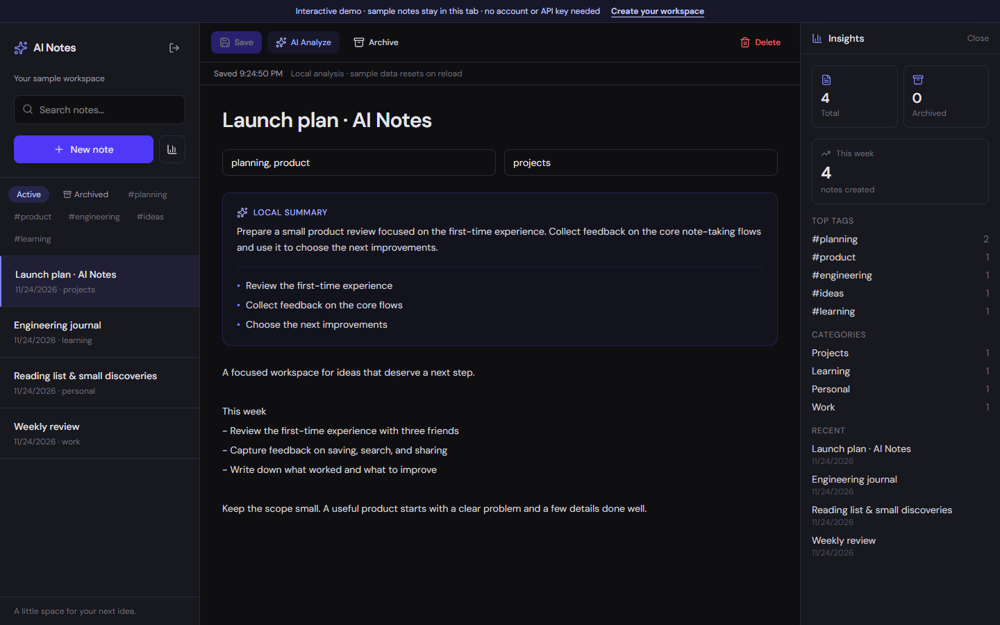

# AI Notes

A focused notes workspace with private accounts, AI summaries, action items, and revocable public links. Built with React, FastAPI, and MongoDB.



**Explore it without an account:** run the frontend and open `/#/demo`. The interactive demo uses sample notes in memory and works without a backend, database, or API key.

## What you can do

- Write and organize notes with tags, categories, literal keyword search, and archive filters.
- Keep unsaved drafts while switching notes; save with **Ctrl/Cmd + S**.
- Analyze the current saved text for a summary and action items. OpenRouter is optional; local extraction works without a key.
- Share a read-only note using an unguessable link. Unsharing revokes that URL permanently; sharing again creates a new one.
- Review note activity, popular tags, and categories in the insights panel.
- Use the workspace on desktop or mobile.

[See the mobile view](docs/images/mobile.png) · [Architecture](docs/ARCHITECTURE.md) · [Deployment](docs/DEPLOYMENT.md) · [Security](SECURITY.md)

## Try the interactive demo

Requires **Node.js 22.13+** and npm. Node 24 is used in CI.

```bash
cd frontend
npm ci
npm run dev
```

Open **http://localhost:5173/#/demo**. You can edit, save, search, archive, and analyze sample notes. Demo changes exist only in the current tab's memory and reset on reload. Local analysis is labeled clearly; the demo does not contact an AI provider. Public sharing requires a real account and backend.

## Run the full app

Requires **Python 3.12–3.14**, **Node.js 22.13+**, and MongoDB. Python 3.12 and 3.14 are configured in CI.

### Option A: Docker Compose

From the repository root:

```bash
python backend/scripts/init_env.py
docker compose --env-file backend/.env up --build
```

Open **http://localhost:8000**. This serves the frontend and API together. MongoDB stays on the private container network; only the app is bound to localhost. Docker must be running.

The setup script generates a private signing secret and never overwrites an existing `.env`. MongoDB data persists in the `mongo-data` volume. Do not delete the volume unless you intend to erase the database.

### Option B: local development

Start MongoDB locally, or use a MongoDB Atlas URI in `backend/.env`.

**Backend — Windows PowerShell:**

```powershell
cd backend
python -m venv .venv
.\.venv\Scripts\Activate.ps1
python -m pip install -r requirements.txt
python scripts/init_env.py
python -m uvicorn app.main:app --reload --port 8000
```

**Backend — macOS/Linux:**

```bash
cd backend
python3 -m venv .venv
source .venv/bin/activate
python -m pip install -r requirements.txt
python scripts/init_env.py
python -m uvicorn app.main:app --reload --port 8000
```

**Frontend — another terminal:**

```bash
cd frontend
npm ci
npm run dev
```

Open **http://localhost:5173** and create an account. Vite proxies `/api` to port 8000. API docs are at **http://localhost:8000/docs**, and readiness is at **http://localhost:8000/api/health**.

## Configuration

| Variable | Purpose |
| --- | --- |
| `SECRET_KEY` | Required generated signing secret, at least 32 bytes. Missing, short, and example placeholders are rejected. |
| `MONGODB_URL` | MongoDB URI; defaults to local MongoDB. |
| `DATABASE_NAME` | Defaults to `ai_notes`. |
| `MONGODB_REQUIRED` | Defaults to true. False allows diagnostics/demo serving without a database; account/note APIs still require one. |
| `CORS_ORIGINS` | Comma-separated frontend origins. Defaults to `http://localhost:5173`. |
| `ACCESS_TOKEN_EXPIRE_MINUTES` | JWT lifetime; defaults to 1440, maximum 10080. |
| `MAX_REQUEST_BYTES` | Request body limit; defaults to 256 KiB. |
| `OPENROUTER_API_KEY` | Optional, server-only. Enables external AI analysis. |
| `OPENROUTER_MODEL` | Provider model identifier; availability depends on the provider. |
| `OPENROUTER_BASE_URL` | Defaults to `https://openrouter.ai/api/v1`. |
| `VITE_API_URL` | Frontend build-time API URL; defaults to `/api`. Set a full HTTPS URL ending in `/api` for separate hosting. |
| `VITE_DEMO_ONLY` | Set true for static portfolio hosting without a backend. Visitors go straight to the sample workspace. |

See [backend/.env.example](backend/.env.example) and [frontend/.env.example](frontend/.env.example). Never put provider keys, database credentials, or the signing secret in a `VITE_*` variable: those values are public browser assets.

## Checks and tests

```bash
cd frontend
npm ci
npm run lint
npm test
npm run build
npm audit
npx playwright install chromium
npm run test:e2e
```

For backend checks, activate its virtual environment, then run:

```bash
cd backend
python -m pip install -r requirements-dev.txt
python -m pytest -q
python -m ruff check .
python -m ruff format --check .
python -m pip_audit --no-deps --disable-pip -r requirements.txt
```

The suite covers account isolation, JWT validation, long passwords and legacy hash upgrades, rate limits, body limits, literal search, pagination, share revocation, stale AI results, and the editor's slow-save and draft-switching regressions. Browser tests cover the signup-free demo and mobile navigation.

Set `MONGODB_TEST_URL` to a disposable MongoDB service to run the real-database integration test. Otherwise it is skipped. It creates and removes only a uniquely named test database. CI runs this test against MongoDB 8.0 on both Python versions.

The [CI workflow](.github/workflows/ci.yml) runs lint, tests, builds, dependency audits, and Gitleaks. [Dependabot](.github/dependabot.yml) proposes dependency updates weekly.

## API at a glance

Authenticated routes require `Authorization: Bearer <token>`.

| Route | Behavior |
| --- | --- |
| `POST /api/auth/signup`, `POST /api/auth/login` | Return an account and JWT |
| `GET /api/auth/me` | Current account |
| `GET /api/notes` | Search/filter/sort; `limit` 1–200 and `offset` pagination |
| `POST /api/notes` | Create a private note |
| `GET/PATCH/DELETE /api/notes/{id}` | Access an owned note |
| `POST /api/notes/{id}/generate-summary` | Analyze saved text |
| `POST /api/notes/{id}/share`, `POST /api/notes/{id}/unshare` | Create/revoke a public link |
| `GET /api/shared/{share_id}` | Public read-only note |
| `GET /api/notes/insights` | Account activity |
| `GET /api/health` | 200 when ready; 503 when the database is unavailable |

## Design and limitations

The code separates browser state, API routes, schemas, authentication, AI services, and database setup. Every private operation checks note ownership. Expensive password work runs outside the API event loop. Distributed rate-limit counters live in MongoDB so multiple API workers share the same limits.

Drafts are retained in memory and a refresh/exit warning protects unsaved work. They are not an offline backup. Multi-tab conflict resolution, password reset, email verification, and collaborative editing are not implemented. Sessions use browser local storage; see the security notes before operating a public service.

AI analysis sends the note title and up to 4,000 content characters to the configured provider. It has no tools or access to other notes. Provider errors fall back to local extraction. Long-note analysis is therefore partial.

No license has been added, at the repository owner's request.
