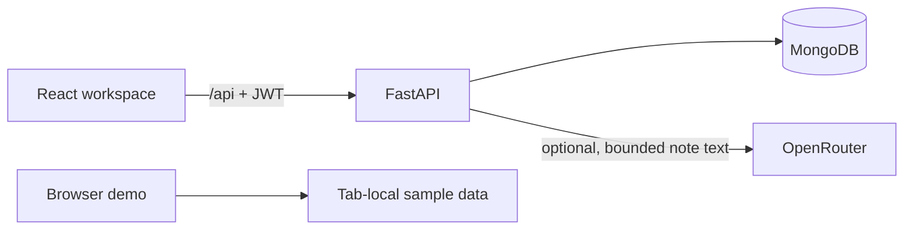

# Architecture

## Data and authorization

Users and notes use full UUID identifiers. Passwords are hashed with Argon2; successful login migrates existing bcrypt hashes. The API signs HS256 tokens with an explicitly required secret and requires both expiry and subject claims.

Private note queries include the authenticated owner. Public reads require both an active sharing flag and a random URL-safe token. Revoking a share removes its token; a subsequent share creates a new one. Public responses expose the author's display name, title, content, tags, category, summary, and update time.

MongoDB indexes enforce email uniqueness, share-token uniqueness, and efficient owner/update-time lookup. TTL-indexed request counters implement shared limits across workers.

## Editor state and slow responses

Saved notes are canonical server state. Unsaved text lives in a separate per-note draft map in the workspace. The editor is keyed by note ID, so switching notes starts the appropriate editing session without copying a delayed response into another note.

A save captures a submitted snapshot. When it finishes, the editor only normalizes that version if the user has not typed something newer. Parent callbacks update selection only when the returned note is still selected. Unsaved drafts survive navigation between notes and trigger a warning before exiting or refreshing.

Analysis, sharing, and archiving persist the draft first. Backend analysis uses a conditional write so a concurrent edit cannot receive an outdated summary. Changing a note's title or content invalidates previous analysis.

## Resource controls

Request bodies are bounded before route processing. Schema limits cover titles, content, tags, categories, and passwords. Search is literal text escaped for MongoDB's regex syntax and has a query deadline. Lists are paginated; insights stream projected metadata and retain only five recent entries.

Authentication limits are keyed by a hashed client address. Notes and AI requests are limited per authenticated account. Only ASGI's client address is used; forwarding headers are trusted only when the server is configured for a known proxy.

## AI and demo boundaries

Provider calls have a timeout and bounded retries. No key or a provider failure invokes local extraction. Logs record error types without note contents or credentials.

The public demo injects a separate in-memory client into the same workspace and editor. It does not create backend accounts or contact the API. Public sharing is unavailable in the demo.

## Stack

- React, React Router, Tailwind CSS, Lucide, Vite
- FastAPI, Pydantic, Motor/PyMongo, PyJWT, Argon2
- Vitest + Testing Library, Playwright, pytest, real-MongoDB CI integration
